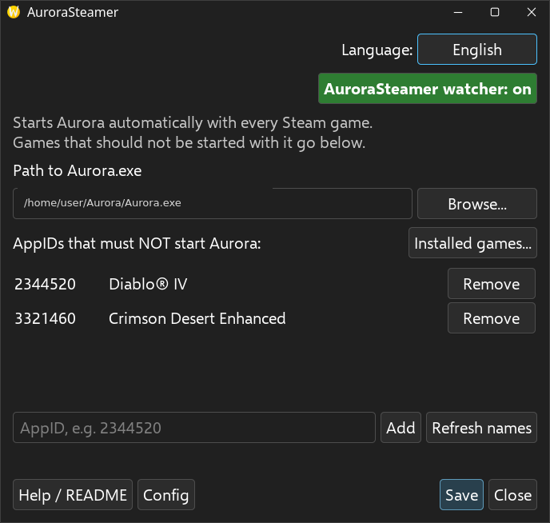
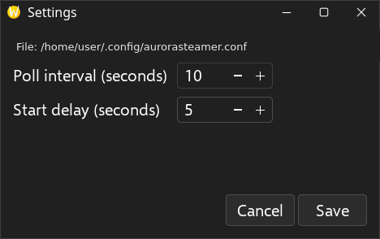
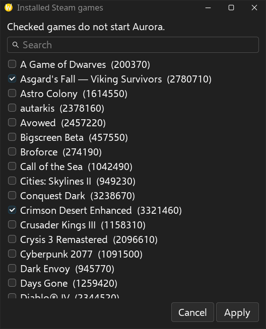
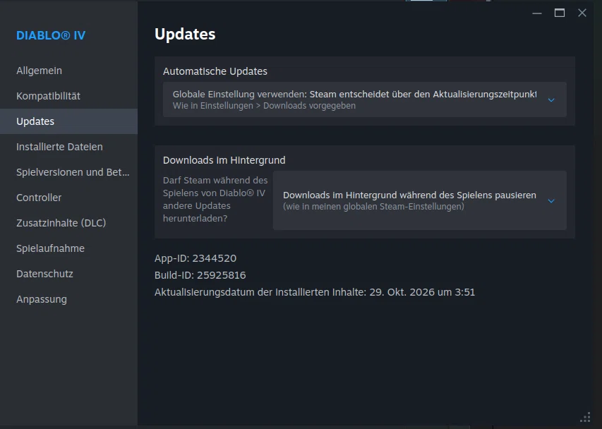

# AuroraSteamer


Starts [Aurora](https://www.cheathappens.com/) automatically inside the Proton
prefix of the running Steam game, so its trainers can attach to the game.

There is a small window for the two settings that matter: the path to
`Aurora.exe` and the list of AppIDs that should **not** start Aurora.

## Screenshots



The settings dialog holds the two timing values the watcher uses:



The game picker, with the AppIDs taken from the Steam manifests:



## Why this is needed

Aurora is a Windows program. Proton gives every Steam game its own Wine prefix,
and a process in one prefix cannot see processes in another. Started in its own
prefix, Aurora lists no running game - without any error message.

This tool starts Aurora inside the prefix of the game, with the Wine binary of
the Proton version that runs the game, on every Proton game unless the game is
listed as an exception.

## What you need

1. **Aurora installed**, for example in `~/Aurora/Aurora.exe`. It has to be a
   copy on a Linux filesystem; running it straight from an NTFS drive works in
   many cases but is slower and can fail on file permissions.
2. **Steam with Proton**, and at least one Proton game installed. Native Linux
   games are not affected by this tool.
3. **A desktop with `bash` and `systemd` user services.** The tool does not
   depend on a specific desktop environment.
4. For the window: **Python 3 with GTK 3** (`python-gobject`, package names vary:
   `python-gobject` on Arch, `python3-gi` on Debian/Ubuntu).
5. Optional: **libnotify** for the save confirmation.
6. Network access for the game names (Steam store API, no key required). The
   tool works without it; only the names stay empty.

## Installation

```bash
git clone https://github.com/SinglerGold2/AuroraSteamer.git
cd AuroraSteamer
./install.sh
```

The installer copies the script and the window to `~/.local/bin`, installs the
systemd user unit, creates the config and exception files if they are missing,
and enables the service.

## Using the window

Start it from the application menu (**AuroraSteamer**) or with:

```bash
aurorasteamer-gui.py
```

The window is available in German and English. The language is picked from the
system locale on first start and can be changed with the selector at the top; the
choice is stored in the configuration file.

The window has three parts:

- **Path to Aurora.exe** - use *Durchsuchen...* if you are unsure where it is.
- **AppIDs** - add an AppID and the window asks the Steam store for the game
  name and shows it next to the number, so you can see what you excluded.
  Names are cached in `~/.cache/aurorasteamer/names.json`. An AppID that does
  not exist in the store is marked as *not found*, a failed lookup as *unknown*;
  the *Refresh names* button tries the unknown ones again. Nothing breaks
  without a network connection.
- **Installierte Spiele...** / **Installed games...** - opens the list of every
  game installed in your Steam libraries. Tick the games that must not start
  Aurora, press *Übernehmen* / *Apply*, done. The list is read from
  `steamapps/libraryfolders.vdf` and the `appmanifest_*.acf` files, so all
  libraries count, no matter which drive they are on. Manually added AppIDs stay
  in the list.

  Entries are **not** removed when a game is uninstalled. That is intentional: if
  you install the game again later, the exception is still there and Aurora stays
  out of it without any further action. Uninstalled games simply disappear from
  the picker, not from the list.
- **AuroraSteamer-Wächter: an / aus** - switches the watcher service on or off;
  the button is green while it runs and red while it is off. Off means Aurora is
  not started automatically; the exception list stays as it is.
- **Config** - opens the settings dialog: poll interval and start delay in
  seconds. Both are written to `~/.config/aurorasteamer.conf`, the file is shown
  in the dialog.
- **Hilfe / README** - shows this file in a window, no external editor needed.

Saving writes the config, writes the exception list and restarts the watcher, so
changes apply immediately. The window stays open after saving; close it with the
*Schliessen* / *Close* button when you are done.

The AppID is the number in a game's store URL, for example
`https://store.steampowered.com/app/3321460/`. You can also read it inside Steam:
right-click the game, *Properties*, *Updates* - the App-ID is shown at the bottom.



## How it works

1. Every `POLL_INTERVAL` seconds the watcher looks for a running Proton game.
2. It reads `STEAM_COMPAT_APP_ID`, `STEAM_COMPAT_DATA_PATH` and
   `STEAM_COMPAT_TOOL_PATHS` from the environment of that process.
3. If the AppID is in the exception list, nothing happens.
4. Otherwise Aurora starts in that prefix, using the game's own Proton.
5. When the game changes, the previous instance is stopped and a new one starts
   in the new prefix.

## Settings dialog

The *Config* button at the bottom opens a small dialog with the two values that
control the watcher:

| Value | Range | Effect |
| --- | --- | --- |
| Poll interval | 1 to 3600 seconds | How often the watcher looks for a running Steam game. 10 seconds is plenty; the check costs about 40 ms. |
| Start delay | 0 to 300 seconds | How long Aurora waits after the game was detected. Useful for slow games that need longer to load. |

The dialog shows the path of the file it writes to, `~/.config/aurorasteamer.conf`.
Saving restarts the watcher, so the new values apply to the next game start.
While no game is running the watcher polls less often (`POLL_IDLE_INTERVAL`,
default 30 seconds); that value is only in the file, not in the dialog.

## Translations

The window reads its texts from `locale/*.json`, next to the installed program in
`~/.local/share/aurorasteamer/locale`. The language picker lists whatever files
are there, so adding `fr.json` adds French to the menu - no code change needed:

```json
{
  "name": "Français",
  "texts": { "title": "AuroraSteamer", "save": "Enregistrer", "...": "..." }
}
```

Shipped languages:

```
locale/de.json    Deutsch
locale/en.json    English
locale/tlh.json   tlhIngan Hol  (yes, really)
```

Every file needs a `name` for the language menu and a `texts` object with the
same keys as `locale/en.json`. Missing keys fall back to English, so a partial
translation is fine. The same folder exists in the repository, which is where you
would add a new language for a pull request.

Missing keys fall back to English.

## Command line

```bash
aurorasteamer.sh --dry-run   # print what would happen, start nothing
aurorasteamer.sh --once      # one check
aurorasteamer.sh             # one check (same as --once)
```

## Configuration file

`~/.config/aurorasteamer.conf`, written by the window. Every setting is
optional and commented in `aurorasteamer.conf.example`:

| Setting | Default | Meaning |
| --- | --- | --- |
| `LANGUAGE` | system locale | Language of the window, `de` or `en` |
| `AURORA_EXE` | `$HOME/Aurora/Aurora.exe` | Path to Aurora.exe |
| `IGNORE_FILE` | `$HOME/.config/aurora-ignore.txt` | Exception list |
| `POLL_INTERVAL` | `10` | Seconds between checks |
| `START_DELAY` | `5` | Seconds to wait before Aurora starts |
| `STATE_FILE` | `$XDG_RUNTIME_DIR/aurorasteamer.state` | Remembers the running instance and whether it was closed |

## Troubleshooting

```bash
journalctl --user -u aurorasteamer.service -f
systemctl --user status aurorasteamer.service
```

- Log and state live in the journal and in `$XDG_RUNTIME_DIR`; nothing is written
  to your home directory apart from the config and the exception list.
- *No game detected*: the game must run through Proton, not natively.
- *Aurora starts but lists nothing*: the game may use a different Wine prefix
  than expected; check the log for the detected prefix.
- *Aurora does not start*: check that `AURORA_EXE` exists and that the game's
  Proton directory contains `files/bin/wine`.

## Limitations

- Games with kernel anti-cheat may dislike any injected program. Add their AppID
  to the exception list.
- Aurora is started once per game session and is not stopped when the game exits.
  The next game start reuses or replaces the instance.
- Tested with Aurora 3.5.x, Proton Experimental and GE-Proton on Arch-based
  distributions with KDE Plasma on Wayland.

## License

GPL-3.0-or-later. See [LICENSE](LICENSE).

## Behaviour in detail

Aurora starts when a Proton game starts, and it can be closed at any time. Three
rules hold:

1. **One instance, ever.** While Aurora runs, no second one is started, even when
   another game comes to the front. The running window is left alone.
2. **Closing is final.** When Aurora disappears while its game still runs, the
   service notes that and does not start it again for that game. Closing it means
   closing it.
3. **A new game starts it again.** When no game is running, the state is cleared,
   so the next game gets a fresh instance.

To force a start while a game runs, delete the state file:

```bash
rm "${XDG_RUNTIME_DIR:-/tmp}/aurorasteamer.state"
```

### What counts as a game

SteamVR reports itself as AppID 250820 while it runs. That is not a game, and
`IGNORE_APPIDS` keeps it, its beta and the Steam Linux Runtime out of the
detection. Without it, every VR session would start Aurora.

The state file stores the PID of the Aurora process itself, found after the
start. wine forks and the launcher exits, so the PID of the launcher would be
dead within seconds and the service would lose track of a window that is still
open.
